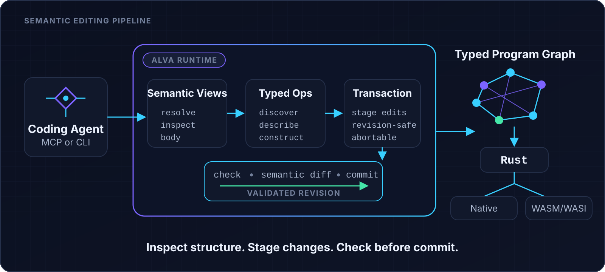

# ALVA

### Semantic editing and checked program changes for coding agents

Inspect a program, prepare a change, check it, and explicitly commit a revision.
ALVA combines a Rust-backed compiler, semantic editing tools and local MCP
integrations. Its experimental maintenance workflow adds Host-owned scope and
behavior checks before publication.

[](https://github.com/zkidp/alva-core/releases/tag/v0.14.1-preview.3)
[](https://github.com/zkidp/alva-core/actions/workflows/ci.yml)
[](LICENSE)

English | [简体中文](README.zh-CN.md)

[Quickstart](#quickstart) · [Connect an agent](#connect-your-coding-agent) ·
[Examples](#examples) · [Latest development](docs/development-preview.md) ·
[Releases](https://github.com/zkidp/alva-core/releases) ·
[Questions / issues](https://github.com/zkidp/alva-core/issues)

> **Developer Preview, not a production guarantee.** The released CLI and the
> newer guarded-maintenance prototype are different versions. Installing the
> release does not install unmerged PR features. See the
> [version-specific development guide](docs/development-preview.md).

## What can I do with it?

| Your goal | Start here |
| --- | --- |
| Try the language and compiler | [Install and check a small program](#quickstart); no API key needed |
| Give an agent structured program tools | [MCP, Codex and Claude Code](#connect-your-coding-agent) |
| Inspect dependencies, stage and review changes | [Native transaction workflow](#how-a-change-works) |
| Try trusted checks before publishing a bounded repair | [Public packing walkthrough](docs/development-preview.md#guarded-maintenance): opt-in development checkout, Linux only |
| Understand actual evidence and limitations | [Development status](docs/development-preview.md), not a claim of higher Agent correctness |

## Workflow preview

<p align="center">
  
</p>

The **newer, opt-in maintenance Host** presents three actions instead of graph
internals. The public scripted walkthrough observes:

```text
read_target       → READY
prepare_change    → REJECTED             malformed body; not published
prepare_change    → VALIDATION_FAILED    behavior test failed; not published
prepare_change    → PREPARED             repaired candidate passes trusted checks
publish_change    → PUBLISHED            scope allowed; fresh authority reread
source handoff    → independently checked source-only project
```

This is an author-scripted engineering example, **not** an Agent success-rate
study or a released CLI command.
[Open its exact version and prerequisites](docs/development-preview.md#guarded-maintenance).

## Quickstart

### 1. Install the CLI

Current CLI Developer Preview: **`v0.14.1-preview.3`**. Installers verify release
archives against `SHA256SUMS.txt`. Review remote scripts before running them;
[manual downloads](https://github.com/zkidp/alva-core/releases/tag/v0.14.1-preview.3)
are also available.

**Windows x64 — PowerShell**

```powershell
irm https://raw.githubusercontent.com/zkidp/alva-core/v0.14.1-preview.3/scripts/install.ps1 | iex
alva --version
alva doctor
```

**Linux x64 / macOS Apple Silicon — terminal**

```bash
curl -fsSL https://raw.githubusercontent.com/zkidp/alva-core/v0.14.1-preview.3/scripts/install.sh | sh
export PATH="$HOME/.local/bin:$PATH"
alva --version
alva doctor
```

The compiler/MCP binary does not require Python or a model account.
Building generated programs also requires **Rust and Cargo**. The experimental
isolated maintenance evaluator has separate Linux prerequisites.

### 2. Check your first program

Download the sample into a new directory:

```powershell
# Windows PowerShell
irm https://raw.githubusercontent.com/zkidp/alva-core/v0.14.1-preview.3/alva/examples/hello.alva -OutFile hello.alva
alva check hello.alva
```

```bash
# Linux / macOS
curl -fsSLO https://raw.githubusercontent.com/zkidp/alva-core/v0.14.1-preview.3/alva/examples/hello.alva
alva check hello.alva
```

With Rust/Cargo installed, run `alva run hello.alva`. Expected program output:

```text
hello, ai-native world
```

Next: [multi-module projects, source builds and troubleshooting](docs/getting-started.md).

## Connect your coding agent

Install ALVA first. The agent must inherit a `PATH` containing `alva`.

| Host | Entry | Instructions |
| --- | --- | --- |
| Local STDIO MCP host | command: `alva`, arguments: `["mcp"]` | [MCP guide](integrations/mcp/README.md) |
| Codex | Thin plugin with the shared ALVA Skill | [Install from a clone](integrations/codex/README.md) |
| Claude Code | `claude mcp add --transport stdio alva -- alva mcp` | [MCP or plugin setup](integrations/claude-code/README.md) |

Packages reuse the same compiler and [canonical Skill](integrations/skills/alva/SKILL.md),
not a second runtime. Agent accounts and permissions are configured separately.
Tool discovery is not proof of task completion; destructive operations still
depend on the host's authorization policy.

## How a change works

The released Native interface exposes explicit transactions:

```text
begin_transaction → resolve / inspect → discover valid operations
                  → stage → semantic diff → check → commit or abort
```

Keep the returned `transaction_id` for subsequent calls. Use the schemas actually
advertised by the installed MCP server: its surface may be narrower than the CLI
registry, especially on older releases.

Private candidates and committed authority are distinct, with stale-write
protection. A check or commit **does not prove task behavior**; independent tests
remain necessary. AIR publication and source projection are separate operations.

## Examples

| Example | What it exercises | Availability |
| --- | --- | --- |
| [Small programs](alva/examples/) | Hello world, collections, contracts and more | This checkout |
| [Incremental build system](examples/build_system/) | Ordering, caching, invalidation, persistence and restart | This checkout; see its [README](examples/build_system/README.md) |
| [Object-store workload](examples/store_split/) | Multi-module storage, authentication and recovery | This checkout; not a production service |
| [Packing maintenance](docs/development-preview.md#guarded-maintenance) | Rejection, repair, guarded publication and source handoff | Pinned development checkout, not the release |
| [JSON Pointer / Patch component](docs/development-preview.md#other-opt-in-work) | Native JSON component and Python caller | Separate development branch, not this checkout |

## Status and boundaries

- **CLI preview:** `.alva` checking, Rust code generation, semantic operations,
  transactional editing and local MCP. Native/WASM builds require the matching
  Rust toolchain.
- **Development prototypes:** guarded maintenance, Python Guard, bounded context
  and components. [Exact versions and entry points](docs/development-preview.md).
- **Not established:** broad Agent correctness gains, superiority to Python or
  strong Git/tests workflows, arbitrary cross-language semantic transactions,
  complete behavioral proofs, or malicious-code isolation from ordinary CLI use.

ALVA is not a drop-in editor for arbitrary Python/TypeScript repositories.
Experimental Python Guard validates patches without creating Python AIR.
Trusted-local checks and temporary directories are not security sandboxes.
Preview APIs and storage formats may change; pin the version you use.

## Documentation and contributing

[Getting started](docs/getting-started.md) · [Latest development and evidence](docs/development-preview.md) ·
[Architecture](docs/assets/alva-architecture.svg) · [Agent Skill](integrations/skills/alva/SKILL.md)

Focused bugs, examples and usability feedback are welcome. Include your OS,
`alva --version`, `alva doctor` and exact command; remove credentials and private
source. See [AGENTS.md](AGENTS.md) for contributor checks and public boundaries.

## License

[Apache License 2.0](LICENSE).
