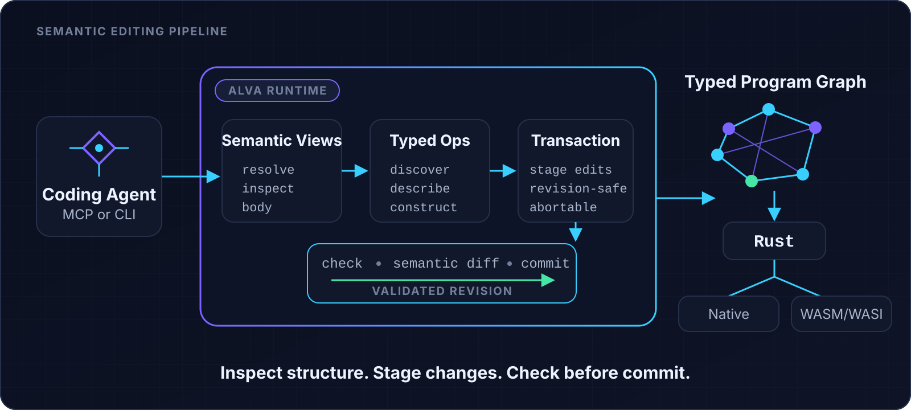

# ALVA

### 面向 Coding Agent 的语义编辑与可检查的程序修改

读取程序、准备修改、执行检查，再明确提交一个新版本。
ALVA 提供基于 Rust 的编译器、结构化语义编辑和本地 MCP 接入；实验中的维护工作流进一步由可信 Host
控制修改范围、行为检查及发布。

[](https://github.com/zkidp/alva-core/releases/tag/v0.14.1-preview.3)
[](https://github.com/zkidp/alva-core/actions/workflows/ci.yml)
[](LICENSE)

[English](README.md) | 简体中文

[快速开始](#快速开始) · [接入 Agent](#接入你的-coding-agent) · [示例](#项目示例) ·
[最新开发进展](docs/development-preview.md) ·
[版本下载](https://github.com/zkidp/alva-core/releases) ·
[问题反馈](https://github.com/zkidp/alva-core/issues)

> **当前是 Developer Preview，不是生产可靠性承诺。** 已发布 CLI 与最新维护原型不是同一个版本。
> 安装发布包不会自动获得未合并 PR 的能力。开发原型请使用
> [明确绑定版本的入口](docs/development-preview.md)，不要混用安装说明。

## 我可以用 ALVA 做什么？

| 你想做的事 | 推荐入口 |
| --- | --- |
| 体验语言和编译器 | [安装并检查第一个程序](#快速开始)，不需要 API Key |
| 给 Agent 接入结构化程序工具 | [MCP / Codex / Claude Code](#接入你的-coding-agent) |
| 读取结构、暂存修改并查看语义差异 | [原生事务流程](#一次修改如何完成) |
| 体验可信检查后的受控发布 | [公开装箱计算示例](docs/development-preview.md#guarded-maintenance)，需要独立开发版本和 Linux 环境 |
| 了解实际证据及限制 | [开发状态](docs/development-preview.md)，不预设 Agent 正确率提升 |

## 工作流预览

<p align="center">
  
</p>

最新的**可选维护 Host 原型**只向调用方提供三个动作。公开脚本实际验证了：

```text
read_target       → READY               取得版本绑定的目标
prepare_change    → REJECTED            语法不合法，不发布
prepare_change    → VALIDATION_FAILED   行为测试失败，不发布
prepare_change    → PREPARED            修复后通过可信检查
publish_change    → PUBLISHED           范围允许，发布后重读权威状态
源码交付          → 独立投影并重新验证
```

这是作者辅助的工程走查，**不是 Agent 成功率实验，也不是已发布 CLI 命令**。
[查看精确版本、配置要求和复现说明](docs/development-preview.md#guarded-maintenance)。

## 快速开始

### 1. 安装 CLI

当前 CLI 开发预览版：**`v0.14.1-preview.3`**。安装器通过 `SHA256SUMS.txt`
核对下载包。运行远程脚本前请先审阅；也可以从
[Release 页面](https://github.com/zkidp/alva-core/releases/tag/v0.14.1-preview.3) 手动下载。

**直接下载安装包：**
[Windows x64 (.zip)](https://github.com/zkidp/alva-core/releases/download/v0.14.1-preview.3/alva-v0.14.1-preview.3-windows-x86_64.zip) ·
[Linux x64 (.tar.gz)](https://github.com/zkidp/alva-core/releases/download/v0.14.1-preview.3/alva-v0.14.1-preview.3-linux-x86_64.tar.gz) ·
[macOS Apple Silicon (.tar.gz)](https://github.com/zkidp/alva-core/releases/download/v0.14.1-preview.3/alva-v0.14.1-preview.3-macos-aarch64.tar.gz) ·
[SHA-256 校验和](https://github.com/zkidp/alva-core/releases/download/v0.14.1-preview.3/SHA256SUMS.txt)

**Windows x64：PowerShell**

```powershell
irm https://raw.githubusercontent.com/zkidp/alva-core/v0.14.1-preview.3/scripts/install.ps1 | iex
alva --version
alva doctor
```

**Linux x64 / macOS Apple Silicon：终端**

```bash
curl -fsSL https://raw.githubusercontent.com/zkidp/alva-core/v0.14.1-preview.3/scripts/install.sh | sh
export PATH="$HOME/.local/bin:$PATH"
alva --version
alva doctor
```

仅使用预编译的编译器/MCP 不需要 Python 或模型账户；构建、运行生成程序还需要 **Rust 与 Cargo**。
实验中的隔离维护验证器另有 Linux 依赖，不能将 CLI 的跨平台支持等同于验证器的跨平台支持。

### 2. 检查第一个程序

请在新目录中下载公开示例：

```powershell
# Windows PowerShell
irm https://raw.githubusercontent.com/zkidp/alva-core/v0.14.1-preview.3/alva/examples/hello.alva -OutFile hello.alva
alva check hello.alva
```

```bash
# Linux / macOS
curl -fsSLO https://raw.githubusercontent.com/zkidp/alva-core/v0.14.1-preview.3/alva/examples/hello.alva
alva check hello.alva
```

安装 Rust/Cargo 后执行 `alva run hello.alva`，程序应输出：

```text
hello, ai-native world
```

下一步：[多模块工程、源码构建及常见问题](docs/getting-started.md)。

## 接入你的 Coding Agent

先安装 ALVA，确保 Agent 启动时继承的 `PATH` 能找到 `alva`。

| 宿主 | 接入方式 | 说明 |
| --- | --- | --- |
| 本地 STDIO MCP 客户端 | command 为 `alva`，arguments 为 `["mcp"]` | [MCP 配置与协议](integrations/mcp/README.md) |
| Codex | 使用共享 ALVA Skill 的薄插件 | [从仓库安装](integrations/codex/README.md) |
| Claude Code | `claude mcp add --transport stdio alva -- alva mcp` | [MCP 或插件配置](integrations/claude-code/README.md) |

这些入口复用同一编译器与 [官方 Skill](integrations/skills/alva/SKILL.md)，不包含第二套运行时。
模型账户和宿主权限单独配置。工具能被发现，不代表 Agent 已能完成维护；提交仍受宿主授权策略控制。

## 一次修改如何完成

已发布原生接口使用显式事务：

```text
begin_transaction → 定位 / 读取 → 发现可用操作
                  → 暂存修改 → 语义差异 → 检查 → 提交或放弃
```

后续调用保留 `transaction_id`，以实际安装版本返回的 MCP Schema 为准。
CLI Registry 的操作范围可能大于旧 MCP 版本，不能假设所有操作都可通过 MCP 调用。

ALVA 区分私有候选与已提交的程序权威状态，并提供过期写入防护。
**检查通过或提交成功不等于行为符合任务**，仍需独立测试。
采用 AIR 权威状态时，发布和源码投影是两个独立步骤。

## 项目示例

| 示例 | 展示内容 | 所在版本 |
| --- | --- | --- |
| [小型语言程序](alva/examples/) | Hello World、集合、契约等 | 当前仓库 |
| [增量构建系统](examples/build_system/) | 依赖排序、缓存、失效传播、持久化与重启 | 当前仓库，见 [运行说明](examples/build_system/README.md) |
| [对象存储工作负载](examples/store_split/) | 多模块存储、鉴权与恢复路径 | 当前仓库；不是生产存储服务 |
| [装箱计算维护](docs/development-preview.md#guarded-maintenance) | 拒绝、修复、受控发布与源码交接 | 绑定版本的开发分支，未发布 |
| [JSON Pointer / Patch 组件](docs/development-preview.md#other-opt-in-work) | 原生 JSON 组件及 Python 调用端 | 独立开发分支，当前仓库未包含 |

## 当前能力与边界

- **CLI 预览版已有：** `.alva` 检查、Rust 代码生成、语义操作、事务编辑和本地 MCP。
  Native/WASM 构建需要对应 Rust 工具链。
- **开发原型：** 高层受控维护、Python Guard、有限上下文和组件工作。
  [精确版本与入口](docs/development-preview.md)。
- **尚未证明：** 普遍提高 Agent 正确率、优于 Python 或强 Git/Tests 流程、任意跨语言语义事务、
  完整行为证明，或普通 CLI 对恶意代码的安全隔离。

ALVA 不是任意 Python/TypeScript 仓库的即插即用语义编辑器。
实验中的 Python Guard 检查补丁，不创建 Python AIR；trusted-local 检查与临时目录不等于安全沙箱。
预览版 API、Schema 与存储格式可能变化，复现时请固定版本。

## 文档与参与

[入门](docs/getting-started.md) · [开发进展与证据](docs/development-preview.md) ·
[架构图](docs/assets/alva-architecture.svg) · [Agent Skill](integrations/skills/alva/SKILL.md)

欢迎提交具体问题、可复现示例与上手反馈。反馈时附操作系统、`alva --version`、
`alva doctor` 和实际命令，并移除凭据与私有源码。贡献前请阅读 [AGENTS.md](AGENTS.md)。

## 许可证

[Apache License 2.0](LICENSE)。
