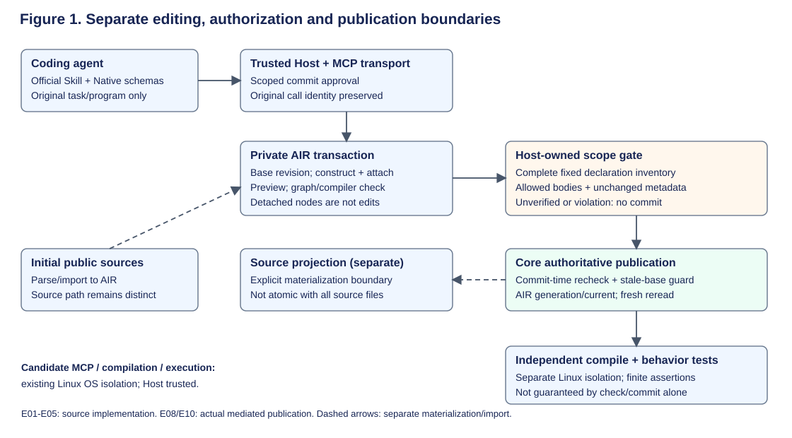
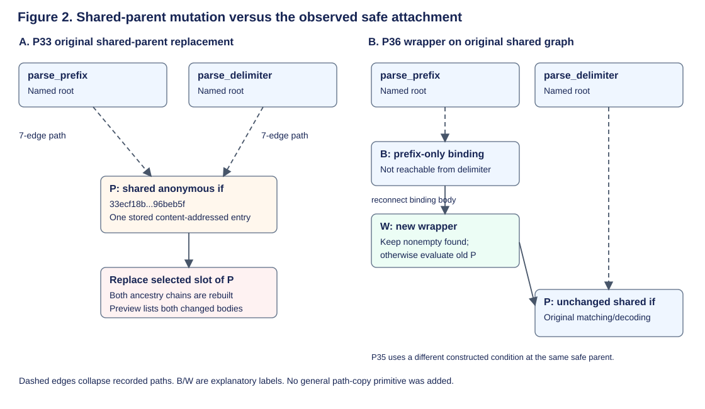
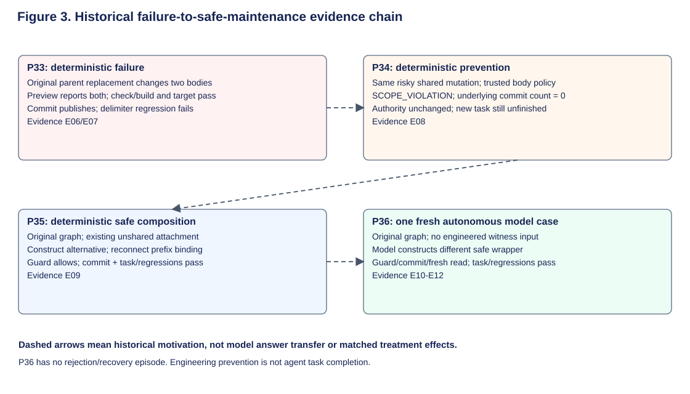

# ALVA: A Case Study of Semantic Editing, Mutation Locality, and Checked Publication in Coding Agents

English research draft 01 · 3 November 2026 · Not submitted

## Abstract

Structure-aware editing gives coding agents explicit program objects, but an
operation on one object need not be local to the declaration that motivated it.
We present ALVA, an implemented language/toolchain with content-addressed program
graphs, staged semantic edits, and checked publication, through an existing-code
maintenance case study. In a query-parser component, a deterministic replacement
of a shared anonymous parent changes both a requested prefix parser and a
protected delimiter parser. Transaction checking and compilation succeed, yet
an independently executed regression fails. The semantic preview already shows
both changes. A host-owned guard subsequently prevents that unauthorized
publication under a fixed, function-body policy. Using existing operations, a
deterministic construction and then one fresh coding-agent run reconnect a
changed subtree through an unshared parent, preserving the original shared node
and passing the original task, regression, and scope checks. A separate model
case completes metadata maintenance; neither observation estimates a success
rate. Four further tasks establish engineering expressibility only. Negative
evidence is retained: an authorized-effect policy study reports no incremental
decision value over strong source diff and tests, and an equal-evidence
measurement comparison finds zero disagreements but remains evidence-limited.
The contribution is a reproducible systems case distinguishing edit locality,
publication authority, and finite behavioral validation—not a new graph-rewrite
theory, a proof of behavioral preservation, or comparative agent superiority.

## 1. Introduction

Coding agents increasingly edit programs through interfaces richer than a text
buffer. SWE-agent studies agent-computer interface design [1](references.md#sweagent),
and CodeStruct exposes named syntactic units and syntax-validated transformations
[2](references.md#codestruct). These systems make it untenable to describe
structured editing itself as a new contribution. A narrower systems question
remains: what does a successful structured edit establish when the underlying
program representation shares structure, the requested change has a limited
authorization scope, and publication is transactional?

Consider maintaining a prefix parser while preserving a delimiter parser in the
same component. The requested semantics are first nonempty decoded prefix in
query order; delimiter parsing must retain its last-match behavior. In ALVA's
original graph, both functions reach the same anonymous conditional. A
replacement addressed to that parent is accepted, passes transaction checking,
and publishes. The prefix requirement is satisfied, but repeated delimiter keys
now produce the wrong result. This is not a hidden preview defect: preview
reports changes to both functions. It is a mismatch between a graph-addressed
mutation and declaration-scoped authorization, followed by a behavioral
regression. [E06](evidence.md#e06), [E07](evidence.md#e07)

ALVA makes this boundary inspectable because its AIR program graph is
authoritative during semantic maintenance. Named declarations lead to anonymous,
content-addressed descendants; AEP operations stage edits; Native MCP exposes an
explicit subset of operations. A trusted host can inspect a staged transaction
before forwarding the original commit. The present case uses that ability to
prevent the known unauthorized change, without claiming that an allowed edit is
behaviorally correct. [E01](evidence.md#e01), [E03](evidence.md#e03),
[E05](evidence.md#e05)

We report three bounded contributions. First, we describe an implemented
semantic-editing/publication pipeline and its separate trust boundaries. Second,
we give a concrete failure–prevention–safe-composition case: shared-parent
propagation, host-mediated rejection, an existing-operation engineering route,
and one autonomous model completion on the original shared program. Third, we
retain evidence that limits stronger claims: engineering qualification is not
agent effectiveness, behavioral evidence is not implied by a commit, and a
strong state-aware baseline recovers the available measurement distinctions.
These contributions are a systems case study, not a controlled estimate of
semantic tools' incremental utility. [E08](evidence.md#e08),
[E09](evidence.md#e09), [E10](evidence.md#e10), [E17](evidence.md#e17),
[E19](evidence.md#e19)

The paper asks: (RQ1) how does the observed local-looking mutation propagate;
(RQ2) what can the existing check, preview, host guard, and tests separately
establish; and (RQ3) can the fixed original case be completed using existing
operations, including by a real coding agent? We do not ask whether ALVA is
generally better than ordinary languages or mature source tools.

## 2. Related Work

**Coding-agent interfaces.** SWE-agent treats the interface as a consequential
part of automated software engineering, rather than a transparent conduit
[1](references.md#sweagent). CodeStruct is the closest structured-action
reference: its readCode/editCode interface operates on named AST entities and
has evaluations on mainstream code tasks across multiple models
[2](references.md#codestruct). ALVA supplies a persistent authoritative graph
and a particular host publication boundary; the evidence here does not compare
its utility with CodeStruct. We do not infer that CodeStruct lacks a guarantee
merely because it was outside the inspected implementation paths.

**Existing transformation tools.** Serena provides symbol-oriented retrieval
and editing through MCP [3](references.md#serena). OpenRewrite uses type-attributed,
format-preserving lossless semantic trees [4](references.md#openrewrite). These
tools establish substantial overlap in structural manipulation and program
navigation. Our case concerns the interaction between content sharing and a
specified publication policy, not the invention of semantic editing. We neither
execute competitor systems nor report external effect-size comparisons.

**Graph rewriting and publication.** Sharing expressions as graph nodes is
classical; Plump surveys term graph rewriting and its relationship to term
rewriting [5](references.md#plump). We use that background to frame aliasing,
not to claim a new copying algorithm or a formal locality theorem. Git's
expected-old-object reference updates and transactions are conventional
publication controls [6](references.md#git). ALVA's AIR identity is useful for
this investigation, but the present evidence does not show that a strong
source-based pipeline cannot enforce the same tested policies.

**Agent evaluation and tool outcomes.** Final-state evaluation is already used
in tau-bench [7](references.md#taubench). Verified Tool Calls addresses
postconditions, retry, and idempotency under simulated non-atomic failures
[8](references.md#verifiedcalls); Callability Is Not Operability examines
action-relevant state and operational uncertainty [9](references.md#aft).
These recent preprints limit any novelty claim based only on naming stages or
checking postconditions. Our contribution is the documented ALVA locality case
and its implemented control, not a general evaluation framework. Comparisons
to these works are bounded by the reading depth in
[references.md](references.md), not an exhaustive priority search.

## 3. System Design

### 3.1 Authority and program identity

ALVA includes a parser/checker, Rust generation, AIR persistence, an AEP
operation registry, CLI dispatch, and a Native MCP surface. AIR nodes contain a
kind, scalar fields, and ordered child slots. A node revision hashes canonical
content including child revisions; the node map is keyed by revision. Identical
anonymous subtrees can therefore share one stored entry. Named module/function
heads provide entry points into that graph. These are implementation facts,
not assumptions that hashes establish correctness or defend against a
compromised trusted host. [E01](evidence.md#e01), [E02](evidence.md#e02),
[E03](evidence.md#e03), [E29](evidence.md#e29)

For Native maintenance, begin captures an authoritative base into a private edit
session. Construction can add detached nodes without changing a target body.
Attachment changes a reachable slot; rebuilding revises affected ancestors.
Preview describes changes, and transaction check validates supported graph and
compiler conditions. Commit rechecks and uses base-revision protection when
publishing the next authoritative AIR generation. Source projection is a
separate materialization step. Consequently, AIR publication does not mean
that all source files and arbitrary external effects were atomically updated.
Evaluation in this case consumes authoritative AIR rather than treating
unchanged source projection as the final candidate. [E01](evidence.md#e01),
[E04](evidence.md#e04), [E26](evidence.md#e26)

**Figure 1. System architecture for the studied Native path.** The solid path
separates agent operations, private staging, graph/compiler check, host scope
authorization, and Core publication. Projection is explicitly separate;
independent compilation/tests are not inside commit. The host and evaluator
are trusted; candidate execution uses the existing Linux OS isolation.
Evidence: E01–E05 and the actual P34/P36 paths in E08/E10. This is an architecture
schematic, not a new trace or a claim of arbitrary external-effect atomicity.

### 3.2 A bounded host-owned scope guard

The optional GuardedNative mediator takes a host-approved policy that the
candidate cannot widen through a tool argument. After begin, it captures the
same transaction's declaration baseline. It traverses the trusted component
inventory, recording function body roots separately from signatures, contracts,
module metadata, declaration order, and non-function structure. The traversal
has a 2,048-node bound; unsupported structure or incomplete coverage is
unverified rather than silently truncated. [E05](evidence.md#e05),
[E23](evidence.md#e23), [E27](evidence.md#e27)

Let A be the trusted set of authorized function bodies and D the set whose
recorded body revisions differ between baseline and staging. For a supported,
complete, otherwise unchanged declaration structure, the guard allows forwarding
only when D is a subset of A. A changed body outside A yields SCOPE_VIOLATION.
Missing baseline or unsupported structural change yields SCOPE_UNVERIFIED.
This describes the implemented decision rule; it is not a proof that all
behavioral consequences are confined to A. A changed authorized callee can
alter an unchanged caller's behavior. [E05](evidence.md#e05)

One session lock covers snapshot comparison through commit forwarding. The
original commit and call identity are retained; the host does not secretly
substitute a rescue commit. Core concurrency checks remain separate. The guard
does not support arbitrary signature, type, contract, or declaration evolution;
it refuses those changes under this body-only policy. A missing trusted
inventory entry can cause rejection of a legitimate candidate, an explicit
coverage/false-rejection tradeoff rather than evidence of task incorrectness.
The guarantee assumes exclusive use of the mediator and an uncompromised host,
Native server, hashing implementation, and OS boundary. [E05](evidence.md#e05),
[E08](evidence.md#e08)

### 3.3 Checks are distinct guarantees

| Boundary | What is observed/enforced here | What does not follow |
| --- | --- | --- |
| Construction and attachment | Node revision and actual reachable target-body change | Constructor success is not a connected edit |
| Transaction check | Supported graph/schema/compiler consistency | User requirement or regression correctness |
| Preview | Named changes in the fixed component | Automatic authorization or complete dynamic impact |
| Host scope gate | Body changes within a complete trusted inventory and authorization | Noninterference of all runtime behavior |
| AIR commit/fresh read | Actual publication and matching authority identity | Behavioral success or atomic source projection |
| Independent execution | Finite task/regression assertions on the candidate | Exhaustive equivalence or universal safety |

**Table 1. Non-interchangeable guarantees.** Implementation and observed
boundaries: E01, E04–E10. “Checked publication” denotes this composition, not
formal verification of arbitrary program behavior.

## 4. Case Study: From Shared Mutation to Safe Maintenance

### 4.1 Original requirement and shared structure

The fixed MM02 component contains the public store.model and store.xml modules,
nine functions, and a component manifest, not the entire storage application.
Its immutable source bundle SHA256 is
`352a8b6fa459942b8b1d5469a966a706498afa7a2abbc13c39c457dafb069faf`.
The requirement is to select the first nonempty **decoded** prefix while leaving
delimiter's last-match behavior and response/XML behavior intact. Baseline
regressions pass; the new prefix requirement fails. The recorded example
`delimiter=%2F&delimiter=%21` must still return `!`.
[E06](evidence.md#e06), [E22](evidence.md#e22)

Both parser roots reach anonymous if-node revision
`33ecf18b03c1348dd59bf91c15f66a73d06cba29dd757254c4e7917ed96beb5f`.
This is not inferred from equal printed source. Recorded seven-edge paths,
inspected slots, recomputed node content hashes, and the node-map implementation
establish that both paths reach one shared entry. The content encoding excludes
an occurrence path or enclosing owner. [E01](evidence.md#e01),
[E06](evidence.md#e06), [E07](evidence.md#e07)

**Figure 2. Shared-node propagation and the observed safe attachment.** Left:
two recorded root paths converge on shared parent P; mutating its slot affects
both ancestry chains. Dashed paths collapse intervening nodes, not missing
direct edges. Right: P36 constructs wrapper W and attaches it through the
prefix-only binding B, leaving P intact. This depicts the observed P36 route;
P35's engineered condition construction differs. Evidence: E06/E07 graph paths,
E09 unshared-parent check, and E10/E28 model operations. Prefix/delimiter root
names and the abbreviated P revision are actual; W/B are explanatory labels,
not invented persistent identifiers.

### 4.2 Deterministic propagation, preview, and behavioral failure

The original Native witness replaces a slot of the shared parent. The executor
resolves parent/child and invokes replace_slot; staging clones the graph for
isolation, then mutates the selected map entry. Whole-program Merkle rebuilding
updates both ancestors. This path is not the explicitly global replace_node
operation. It is shared-parent mutation followed by rebuilding, inside a private
transaction. Prior discovery of the prefix function does not turn a parent
revision into an occurrence-scoped capability. [E01](evidence.md#e01),
[E29](evidence.md#e29), [E22](evidence.md#e22)

Both parser body roots change. Preview correctly lists parse_prefix and
parse_delimiter. Transaction check reports no problems; commit and a fresh
authority read agree. Independent check/build and the target test pass, but the
delimiter regression executes and returns `/` rather than `!`. The Text witness
passes target and regressions. Thus the evidence distinguishes representable
program validity from the requested maintenance semantics. It does not show
that every structured edit propagates incorrectly. [E06](evidence.md#e06)

A mechanism control alpha-renames only delimiter's accumulator and its reference.
That makes the selected parent unshared while preserving baseline behavior.
The original mutation sequence then changes prefix only and passes task and
regressions. This supports the alias-propagation explanation but is not a
solution on the original graph; it is neither a replacement task nor a model
success. [E06](evidence.md#e06), [E07](evidence.md#e07)

### 4.3 Prevention is not completion

The host guard applies the unchanged risky sequence to the original shared
program and identifies delimiter as unauthorized. The commit is rejected before
Native dispatch; authority remains unchanged. The prefix task therefore remains
unfinished, while baseline regressions continue to pass. Calling that outcome
successful maintenance would confuse prevention with completion.
[E08](evidence.md#e08)

The same engineering validation forwards a nonshared control and a legal MM01
body edit, and refuses a deliberately incomplete trusted inventory. These are
four deterministic cases—two forwards and two denials—not four model trials or
a reliability percentage. The scripted Responses/AppServer route validates
actual dispatch mediation without an upstream model call.
[E08](evidence.md#e08), [E23](evidence.md#e23)

### 4.4 Safe composition on the original graph

The original prefix and delimiter conditionals are shared, but their immediate
rest-binding parents are not: they strip different query keys. P35 establishes
that prefix's binding is absent from delimiter's reachable graph. Existing
constructors can build an alternative conditional and reconnect it at that
prefix-only binding without mutating the original shared parent. No new
occurrence-copy primitive or variable renaming is needed for this case.
[E09](evidence.md#e09), [E24](evidence.md#e24)

The deterministic routes retain useful failures: detached construction leaves
all bodies unchanged and is aborted; the original shared mutation is refused by
the guard; binding reconnection changes prefix only, is allowed, publishes, and
passes original task/regression/scope checks. Delimiter and the original shared
if remain unchanged. This is fixed-case expressibility, not general path-copy
semantics for graphs lacking an available unshared attachment point.
[E09](evidence.md#e09)

### 4.5 One autonomous completion

P36 starts one fresh Native session on the original shared bundle. The model
receives the public requirement, original program, general documents, and the
official Skill, but not the engineered witness or hidden evaluation source.
It constructs a nonempty-accumulator condition and a wrapper that retains found
when nonempty, otherwise evaluates the old conditional. It attaches the wrapper
at the prefix binding, previews, checks, inspects, and commits. This is not an
exact replay of P35's candidate construction. [E10](evidence.md#e10),
[E11](evidence.md#e11), [E25](evidence.md#e25), [E28](evidence.md#e28)

The actual guard allows the original model commit, the underlying Native call
publishes, and a fresh process reads the matching authority. The resulting
prefix body differs; all eight other function bodies and source/manifest bytes
are unchanged. Independent original task, regressions, and scope pass. No guard
rejection occurred in this run, so it is **not** evidence that the model recovered
after a rejection. “Failure to recovery” in Figure 3 refers to the historical
engineering evidence chain, not within-session agent recovery.
[E10](evidence.md#e10)

**Figure 3. Failure-to-safe-maintenance evidence flow.** P33 deterministic
failure → P34 prevention → P35 deterministic safe composition → P36 autonomous
completion. These are different evidence units and implementations, not a
paired longitudinal performance experiment. Dashed connectors mean historical
motivation, not transfer of a witness/answer into the model input. Inputs:
E06, E08–E12. No sample size or effect is obtained by summing the boxes.

## 5. Evaluation

### 5.1 Design and provenance

This is a retrospective systems case study of already frozen executions, not a
new treatment trial. The manuscript adds no model generation, candidate
execution, or token-count API calls. Its canonical evidence tree is commit
`469358649e256ddff8c37baf421def25abc11671`. The public
[evidence index](evidence.md) binds each cited file to exact Git-blob SHA256,
last-change commit, and selected JSON assertions. Original runtime freezes and
controlled archive digests retain their distinct meanings; the current paper
base is not substituted for the historical execution SDK.

The case was selected because the original shared-parent counterexample was
already known. It therefore supports mechanism description and fixed-case
feasibility, not prevalence estimation. P33–P35 are Codex-assisted deterministic
engineering; P32 and P36 are separate real-model observations. The oracles were
independently **executed**, but are not claimed to be independently authored by
human experts. No clean contemporaneous Text-versus-Native agent comparison is
reported. [E22](evidence.md#e22)–[E26](evidence.md#e26)

| Evidence unit | Changed bodies | Check/build | Actual publication | Independent target / regressions |
| --- | --- | --- | --- | --- |
| P33 original Native witness | Prefix and delimiter | Pass | Yes | Pass / **Fail** |
| P33 Text witness | Source-local prefix edit | Pass | Source path, not AIR commit | Pass / Pass |
| P34 original shared witness | Prefix and delimiter staged | Check passes | **Blocked** | Baseline task fails / Pass |
| P35 safe reconnection witness | Prefix only | Pass | Allowed and fresh-read | Pass / Pass |
| P36 fresh real model | Prefix only | Pass | Allowed and fresh-read | Pass / Pass |

**Table 2. Layered results, not a pooled success sample.** Exact rows: E06,
E08, E09, E10. The P34 task failure is expected unfinished baseline behavior;
the unsafe staged candidate was not published and then credited as correct.

### 5.2 Model observations and resource accounting

Both model cases use the recorded `gpt-5.6-sol / low` configuration, twenty
Native MCP tools, an official Skill, a new session, and isolated candidate
execution. Their freezes differ: P32 uses Codex CLI 0.163.0-alpha.11.2; P36
uses 0.166.0-alpha.5.1 and a later recorded SDK build. We do not treat them as
exchangeable repetitions. Each allows 80 model tools, 480 active-turn seconds,
a 600,000 cumulative reported-token observation threshold, and 20 seconds
interrupt grace. The threshold is not a provider hard token cap; neither case
reaches it. [E11](evidence.md#e11), [E14](evidence.md#e14),
[E25](evidence.md#e25), [E26](evidence.md#e26)

| Recorded observation | P32 MM01 | P36 MM02 |
| --- | ---: | ---: |
| Model tool calls | 19 | 18 |
| Native calls | 16 | 15 |
| Reported input tokens | 273,563 | 267,370 |
| Cached input, already included | 251,904 | 217,216 |
| Reported output tokens | 1,448 | 1,604 |
| Reported total tokens | 275,011 | 268,974 |
| Active-turn seconds | 35.872 | 36.093 |
| Task / regression / scope | Pass / Pass / Pass | Pass / Pass / Pass |

**Table 3. Two separate developmental observations.** Values are public
RESULTS records (E10/E13), not estimated costs. Cached input is not subtracted;
reasoning output is included in output, not added again. Totals are cumulative
reported usage, not unique context size. Provider request counts and dollar
costs are unavailable. No inference about comparative efficiency is made.

MM01 preserves metadata for negative sizes while retaining the ordinary
increment behavior for nonnegative sizes and other component requirements.
Its fresh model run changes the intended body, commits, and passes finite task,
regression, and scope evaluation. A prior blocked run remains blocked, with
staged behavior NOT_INDEPENDENTLY_EVALUATED. We neither pool that run with P32
nor pair P32 with a historical Text result. [E13](evidence.md#e13),
[E26](evidence.md#e26), [E19](evidence.md#e19)

### 5.3 Engineering breadth and retained negative evidence

P37 registers four maintenance candidates: topological-order error completeness,
cache-state reuse, stable reverse-dependency deduplication, and XML escaping.
All four eventually have qualified Text and Native engineering witnesses under
fixed assertions. They derive from only two component sources; three share one
build module. The first Native engineering wave's four failures are retained,
followed by one corrected wave without changing tasks or assertions. These are
author-assisted engineering attempts, not four new agent successes or an
unbiased multi-project benchmark. [E15](evidence.md#e15), [E16](evidence.md#e16)

P38 examines an authorized-effect policy against stronger alternatives on four
synthetic cases. The source-diff/test baseline A and proposed composition D
make the same four registered decisions; both are offline decision simulations.
The dependency-oriented B matches three; the actual structural Guard C matches
two under the stronger registered policy. A protected caller can regress while
only an authorized callee body changes, and tests alone do not meet an explicit
proof requirement. These do not contradict C's body-scope guarantee. The
disposition remains **NO_OBSERVED_INCREMENTAL_VALUE**: the policy composition
does not establish extra decision power over equal-evidence strong source
checks. No simulated denial is described as a prevented real publication.
[E17](evidence.md#e17), [E18](evidence.md#e18), [E30](evidence.md#e30)

RDR-02 then compares a strong call/target-state/tested-publication baseline E0
with object-bound realization analysis E1 on four selected historical evidence
units. E0 receives the same available graph/state evidence as E1. Both recover
coverage refusal (P24, not a model task), a published unchanged target (P26),
connected-but-denied staging (P30), and committed target changes with passing
tests (P32). There are **zero E0/E1 disagreements**. The primary disposition
nevertheless remains **INCONCLUSIVE_EVIDENCE_LIMITATION**: records co-record
final files, fresh authority, and evaluation, but do not separately echo the
evaluated revision. [E19](evidence.md#e19), [E20](evidence.md#e20),
[E31](evidence.md#e31), [E32](evidence.md#e32)

That qualification distinguishes a stronger self-contained receipt from the
trusted finalizer's existing binding. It is not evidence of testing the wrong
program and does not rescore P32's historical success. The available parity
does not justify a new measurement mechanism, and missing evidence does not
favor E1. RDR-01's synthesis is background interpretation, not an additional
effect sample or an independent validation of every archived trace.
[E20](evidence.md#e20), [E21](evidence.md#e21)

## 6. Threats to Validity

**Selection and external validity.** The main case is a deliberately investigated
shared-parent failure in a small ALVA component. Its graph structure, supported
constructors, and unshared attachment point make the safe route possible. It
does not establish that arbitrary shared graphs admit that route, or that
mainstream source systems need persistent AIR. P37 adds task types but only two
correlated components. Custom-language familiarity and unusual interfaces are
confounded with agent performance; there is no Python superiority comparison.

**Author and oracle dependence.** Codex assisted the implementation, engineering
witnesses, tests, evidence analysis, figures, and manuscript. We do not label
this model-free development or independent human ground truth. The original
model experiments withheld witnesses and hidden assertions from runtime input,
but the authors' accumulated understanding still influenced task and mechanism
selection. Finite assertions can miss behavior; correlated specification and
implementation mistakes remain possible. An external reviewer is needed.

**Measurement and version binding.** Node hashes are content identities under
the implemented encoding, not correctness certificates. RDR-02's missing
standalone evaluated-revision receipts remain UNKNOWN in that analysis.
Successful tool return, preview, check, or commit alone is insufficient.
Private raw transcripts are not published; public hashes and derived records
cannot replace access when independently replaying provenance. This manuscript
does not newly reopen all private archives or execute historical candidates.

**Configuration and safety assumptions.** Model sessions, CLI/SDK versions,
documents, and host settings are pinned per execution but not identical across
historical nodes. Tool schemas and the official Skill provide extra information
relative to text tools; any utility attribution would require a fresh fair
comparison. The host is trusted, isolated execution is Linux-only, and the
fixed-body Guard intentionally rejects unsupported structure. Neither a
temporary directory nor a read-only host configuration is a substitute for the
recorded OS isolation. Concurrency protection, locality authorization, and
behavioral correctness are separate; the model cases do not test crash/stale
recovery or arbitrary external-side-effect rollback.

**Statistical and reporting validity.** Two different selected S-only successes
do not identify a probability, a causal treatment effect, or an efficiency
distribution. Engineering attempts and model runs are not interchangeable
denominators. We conduct no significance tests and compute no pooled success
rate. Reported token thresholds are observation policies with possible overshoot,
not proven hard resource bounds. Closed experiments and negative dispositions
are retained rather than repaired into favorable outcomes.

## 7. Discussion

### 7.1 What the case adds

The useful systems result is the separation of **where a mutation is addressed**,
**what declaration changes it causes**, **whether that scope is authorized**, and
**whether the published program meets the task**. P33 exposes a concrete
representation-dependent route from the first to the second. P34 mediates the
second-to-publication boundary. P35 shows the original case is expressible
without new primitives. P36 shows one agent actually uses an existing safe
composition and completes the full path. None of these statements implies the
next one automatically.

This narrative is intentionally not an improvement curve. The stages differ in
evidence type, host configuration, and purpose. In particular, P34 prevents an
unauthorized publication but does not teach the model how to finish the task;
P36 does not demonstrate learning from a rejection within its session. What
can be reviewed is the concrete mechanism and implemented boundary, not a
post-hoc causal claim that the guard produced the successful model behavior.

### 7.2 Structural authorization is narrower than behavioral authorization

Protecting delimiter's body catches this particular spill. It cannot establish
that changing an authorized helper leaves every caller's result intact. P38's
caller-regression case is therefore a useful limit, not an inconvenient anomaly.
A stronger behavior policy requires additional evidence, and ordinary tests
may already supply that evidence. Adding policy text or an impact explanation
does not by itself add verification power. The same caution applies to naming
more treatment-realization stages: equal-evidence parity in RDR-02 does not
become novelty through a different report format.

### 7.3 Why retain ALVA without a superiority claim?

An authoritative graph, explicit sessions, and observable publication provide a
controlled setting for exposing and reproducing these boundaries. That is a
reason to retain ALVA as a research system, not a reason users must replace
their languages. CodeStruct, Serena, OpenRewrite, Git, and tests offer substantial
overlapping functionality. Our data establish no irreplaceable ALVA dependency
for the tested policies. The appropriate artifact is a technical systems/case
study for external critique, not a promise of a general correctness product.

The present result supports maintaining the demonstrated implementation and
publishing its limitations clearly. It does not authorize more calibration,
new language/AEP operations, a new adapter, or paid experiments to search for
positive effects. Any later utility claim would need its own prospectively
approved evaluation rather than reinterpretation of these cases.

## 8. Conclusion

ALVA's shared program representation makes graph-addressed mutation and
declaration-local intent meaningfully different. In the fixed parser case,
preview observes a cross-function change, checking accepts it, and independent
execution reveals a regression. A host-owned scope guard prevents its
unauthorized publication, while existing operations permit a safe reconnection
on the original shared graph. One fresh agent run completes that route, and a
separate metadata run supplies another bounded maintenance observation. Neither
is an effectiveness estimate. Engineering qualification, a negative
authorized-effect comparison, and an evidence-limited zero-disagreement
measurement comparison constrain the contribution. The result is an implemented,
inspectable case of semantic editing and checked publication with explicit
locality and evidence limits—not proof of general agent reliability.

## 9. Artifact and Reproducibility Statement

The complete manuscript, references, figure sources, exact evidence index, and
read-only validation instructions accompany this draft in
`docs/papers/alva-case-study-v0/`. Start with [README.md](README.md). The paper
validator checks pinned public bytes, selected factual assertions, citations,
links, and reproducible SVG generation; it does not rerun a model or certify
all prose claims. Original candidate execution requires the historical Linux
sandbox/toolchains and controlled archives, whose access limits are listed.
No private E5/SS data or hidden evaluation source is reproduced in this draft.
This is an unsubmitted author-assisted manuscript awaiting external review.

## References

The numbered bibliography, immutable repository pins, source access dates, and
reading-depth qualifications are in [references.md](references.md).
